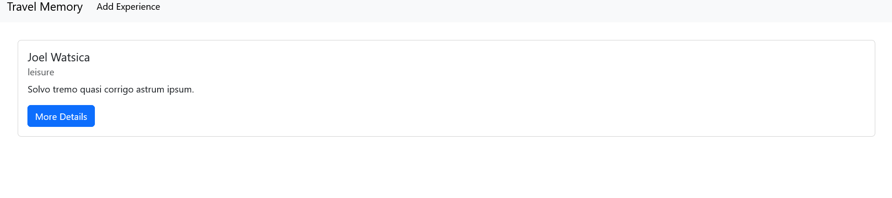
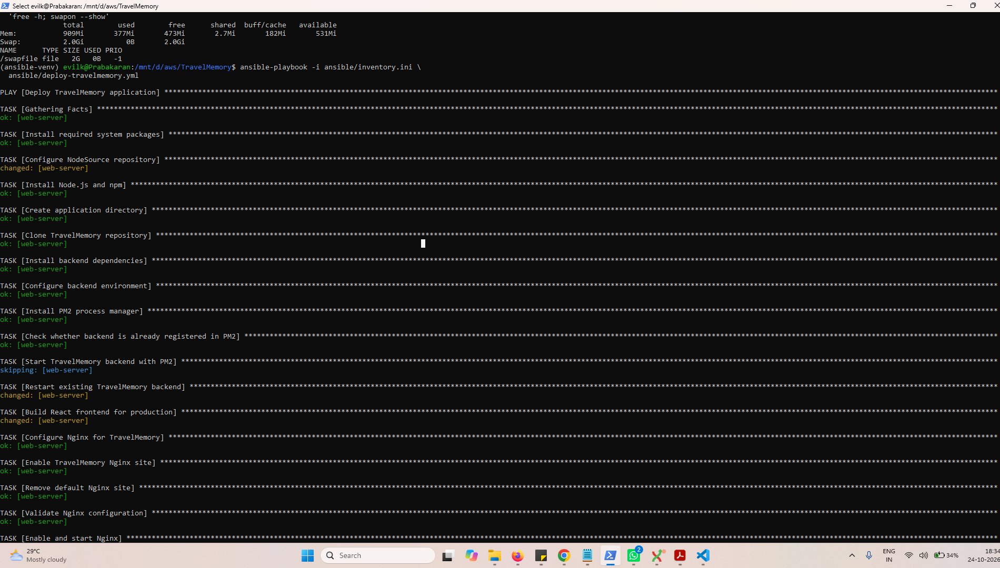
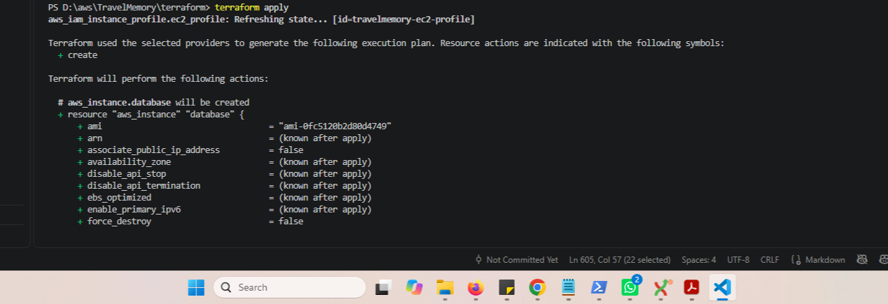

# TravelMemory — MERN Application Deployment Using Terraform and Ansible

**GitHub Repository:** [https://github.com/karan11619/TravelMemory](https://github.com/karan11619/TravelMemory)

## 1. Project Overview

This project demonstrates deploying the TravelMemory MERN application on Amazon Web Services (AWS) using **Terraform for Infrastructure as Code (IaC)** and **Ansible for configuration management and application deployment**.

TravelMemory is a travel experience application that allows users to add, view, and retrieve trip details.

The application uses React for the frontend, Node.js and Express for the backend API, and MongoDB for data storage. Nginx serves the production frontend and forwards API requests to the backend.

### Objectives

- Provision AWS infrastructure using Terraform.
- Configure a VPC with public and private subnets.
- Deploy separate EC2 instances for the web application and database.
- Configure an Internet Gateway, NAT Gateway, route tables, and security groups.
- Install and configure MongoDB using Ansible.
- Deploy the Express backend and React frontend using Ansible.
- Configure Nginx as the frontend web server and API reverse proxy.
- Verify that users can save and retrieve travel experiences.

## 2. Technology Stack

| Technology | Purpose |
|---|---|
| AWS VPC | Network isolation |
| Amazon EC2 | Web and database servers |
| Terraform | Infrastructure provisioning |
| Ansible | Configuration management and deployment |
| Ubuntu | Server operating system |
| Node.js | JavaScript runtime |
| Express.js | Backend REST API |
| React | Frontend application |
| MongoDB | Database |
| Mongoose | MongoDB object modeling |
| Nginx | Frontend hosting and reverse proxy |
| PM2 | Backend process management |
| Git and GitHub | Version control |

## 3. AWS Architecture

The application is deployed in the AWS Mumbai region (`ap-south-1`).

```text
                         Internet
                            |
                     Internet Gateway
                            |
                     Public Subnet
                            |
                    Web EC2 Instance
                     Ubuntu / Nginx
                            |
                  +---------+---------+
                  |                   |
             React Frontend      Express API
                  |                   |
                  +---------+---------+
                            |
                    Private Subnet
                            |
                   Database EC2 Instance
                         MongoDB
                       Port 27017

       Private subnet outbound access uses NAT Gateway
```

### Architecture Components

- **VPC:** Provides an isolated AWS network.
- **Public subnet:** Hosts the web EC2 instance.
- **Private subnet:** Hosts the database EC2 instance without a public IP.
- **Internet Gateway:** Enables internet connectivity for resources in the public subnet.
- **NAT Gateway:** Allows eligible private-subnet resources to initiate outbound internet connections.
- **Security groups:** Control permitted network traffic.
- **IAM instance profile:** Associates an IAM role with EC2 instances.
- **Terraform:** Creates and manages the infrastructure.
- **Ansible:** Configures the servers and deploys the application.

### AWS Resource Configuration

| Resource | Configuration |
|---|---|
| Region | `ap-south-1` |
| VPC CIDR | `10.0.0.0/16` |
| Public subnet | `10.0.1.0/24` |
| Private subnet | `10.0.2.0/24` |
| Web EC2 instance | `t3.micro` |
| Database EC2 instance | `t3.micro` |
| Backend port | `3001` |
| MongoDB port | `27017` |
| Frontend HTTP port | `80` |

The public IP and private IP addresses can change when infrastructure is recreated. Retrieve current values from Terraform outputs or the AWS console.

## 4. Repository Structure

```text
TravelMemory/
├── backend/
│   ├── controllers/
│   ├── models/
│   ├── routes/
│   ├── conn.js
│   ├── index.js
│   └── package.json
├── frontend/
│   ├── public/
│   ├── src/
│   └── package.json
├── terraform/
│   ├── provider.tf
│   ├── main.tf
│   ├── iam.tf
│   └── outputs.tf
├── ansible/
│   ├── inventory.ini
│   ├── install-mongodb.yml
│   └── deploy-travelmemory.yml
├── .gitignore
├── README.md
└── LICENSE
```

## 5. Prerequisites

Before starting the deployment, ensure the following are available:

- An AWS account with appropriate permissions.
- AWS CLI configured with valid credentials.
- Terraform installed on the local machine.
- Ubuntu on WSL or another Ansible control machine.
- Ansible installed in a Python virtual environment.
- The `community.general` Ansible collection.
- Git installed and access to the GitHub repository.
- An existing AWS EC2 key pair and its matching private key.

Never commit private SSH keys, AWS credentials, or environment files to GitHub.

## 6. Part 1 — Infrastructure Provisioning with Terraform

Terraform is used to provision the AWS infrastructure.

### 6.1 Configure AWS CLI

Configure the AWS CLI using your preferred secure authentication method. Verify that the correct AWS account is selected before provisioning resources.

```powershell
aws sts get-caller-identity
aws configure get region
```

The intended AWS region is `ap-south-1`.

### 6.2 Initialize Terraform

Open PowerShell and navigate to the Terraform directory:

```powershell
cd D:\aws\TravelMemory\terraform

terraform init
terraform validate
terraform plan
```

Review the proposed resources before applying the configuration.

### 6.3 Provision AWS Resources

```powershell
terraform apply
```

Review the plan and confirm the operation when prompted.

Terraform provisions the network, subnets, gateways, route tables, security groups, IAM instance profile, and EC2 instances defined in the configuration.

### 6.4 Retrieve Terraform Outputs

```powershell
terraform output
```

Use the output values to identify the web server's public IP address and the database server's private IP address.

### 6.5 Network Security

The intended network configuration includes:

- SSH access to the web instance restricted to an authorized client IP.
- HTTP access through port `80`.
- HTTPS access through port `443` when HTTPS is configured.
- MongoDB traffic on port `27017` permitted from the web server security group.
- SSH access to the database server restricted to the web server security group.
- No public IP address on the database instance.

## 7. Part 2 — Ansible Configuration

Ansible automates server configuration and application deployment.

### 7.1 Activate the Ansible Environment

In Ubuntu WSL:

```bash
source ~/ansible-venv/bin/activate
cd /mnt/d/aws/TravelMemory
```

### 7.2 Install the Required Collection

```bash
ansible-galaxy collection install community.general
```

### 7.3 Verify Server Connectivity

```bash
ansible -i ansible/inventory.ini web -m ping

ansible -i ansible/inventory.ini database -m ping
```

Both hosts should respond successfully.

The database host is reached through SSH ProxyCommand using the web server as a jump host.

### 7.4 Check Playbook Syntax

```bash
ansible-playbook -i ansible/inventory.ini \
  ansible/install-mongodb.yml --syntax-check

ansible-playbook -i ansible/inventory.ini \
  ansible/deploy-travelmemory.yml --syntax-check
```

## 8. Part 3 — MongoDB Installation and Configuration

MongoDB is installed on the database EC2 instance using the Ansible playbook.

### 8.1 Run the MongoDB Playbook

```bash
ansible-playbook -i ansible/inventory.ini \
  ansible/install-mongodb.yml
```

### 8.2 Verify MongoDB

```bash
ansible -i ansible/inventory.ini database -b \
  -m command -a "systemctl is-active mongod"
```

The expected result is:

```text
active
```

### 8.3 MongoDB Network Configuration

MongoDB listens on the database server's loopback address and private IP address. The database security group restricts port `27017` to the web server security group.

Test connectivity from the web instance:

```bash
nc -zv <DATABASE_PRIVATE_IP> 27017
```

A successful connection confirms that the network path to the MongoDB port is available.

### 8.4 Database Connection String

The backend uses the `MONGO_URI` environment variable.

Example:

```env
MONGO_URI=mongodb://<DATABASE_PRIVATE_IP>:27017/travelmemory
```

The database private IP must match the current Terraform output.

**Security note:** The example connection string does not enable MongoDB authentication. For production, configure database users, authentication, and appropriate access controls.

## 9. Part 4 — Application Deployment with Ansible

The `deploy-travelmemory.yml` playbook installs the application dependencies and configures the web server.

### 9.1 Run the Deployment Playbook

```bash
ansible-playbook -i ansible/inventory.ini \
  ansible/deploy-travelmemory.yml
```

The playbook performs the following tasks:

1. Installs Git, Node.js, npm, Nginx, and required system packages.
2. Clones the TravelMemory GitHub repository.
3. Installs backend dependencies.
4. Creates the backend environment configuration.
5. Starts the Express backend using PM2.
6. Installs frontend dependencies and creates the React production build.
7. Configures Nginx to serve the React application.
8. Configures Nginx to proxy API requests to the backend.
9. Enables Nginx and configures PM2 process management.

### 9.2 Backend Environment Variables

The backend uses a `.env` file similar to the following:

```env
PORT=3001
MONGO_URI=mongodb://<DATABASE_PRIVATE_IP>:27017/travelmemory
```

The environment file is stored on the server and should not be committed to GitHub.

### 9.3 Frontend API Configuration

The frontend uses a relative API URL:

```javascript
export const baseUrl = process.env.REACT_APP_BACKEND_URL || "";
```

The frontend makes requests to `/trip`. Nginx forwards those requests to the Express backend on port `3001`.

Using a relative API URL avoids sending browser requests to `localhost`, which would refer to the visitor's own computer.

### 9.4 Nginx Configuration

Nginx serves the React production build and forwards requests to the backend API.

The configured routes include:

- `/` — React frontend.
- `/trip` — Create or retrieve travel experiences.
- `/trip/:id` — Retrieve a specific travel experience.
- `/hello` — Backend health-check endpoint.

### 9.5 Backend Process Management

PM2 runs the Express backend as a managed process.

Check the process:

```bash
pm2 status
```

Inspect backend logs:

```bash
pm2 logs travelmemory-backend --lines 50
```

## 10. Part 5 — Verification and Testing

After deployment, the frontend, backend, and database integration were tested.

### 10.1 Backend Health Check

Run on the web EC2 instance:

```bash
curl -i http://127.0.0.1:3001/hello
```

Expected response:

```text
HTTP/1.1 200 OK
Hello World!
```

### 10.2 Frontend Verification

Open the web server's public IP in a browser:

```text
http://<WEB_SERVER_PUBLIC_IP>
```

Verify that the TravelMemory homepage loads successfully.

### 10.3 API Verification

```bash
curl -i http://<WEB_SERVER_PUBLIC_IP>/trip
```

The API should return JSON containing the saved trip records. If no records exist, an empty array may be returned.

### 10.4 Add and Retrieve Travel Experiences

The following application functionality was verified:

- Opened the deployed TravelMemory frontend.
- Added a travel experience using the Add Experience form.
- Confirmed that trip details were saved.
- Refreshed the application and verified that saved trip details could be retrieved.

### 10.5 Ansible Deployment Result

The final successful deployment completed with zero failed and zero unreachable tasks.

## 11. Troubleshooting

This section documents issues encountered during deployment and their solutions.

### 11.1 SSH Access to the Private Database Instance

**Problem:** The database EC2 instance has no public IP and cannot be accessed directly from the internet.

**Solution:** Connect through the web server using SSH ProxyCommand. Ensure the database security group permits SSH only from the web server security group.

Example:

```bash
ssh -i ~/.ssh/travelmemory-rsa \
  -o IdentitiesOnly=yes \
  -o "ProxyCommand=ssh -i ~/.ssh/travelmemory-rsa -o IdentitiesOnly=yes -W %h:%p ubuntu@<WEB_PUBLIC_IP>" \
  ubuntu@<DATABASE_PRIVATE_IP>
```

### 11.2 MongoDB Service Failed to Start

**Problem:** MongoDB 8.0 failed to start because of a kernel compatibility issue reported by that MongoDB version.

**Solution:**
- Review the MongoDB service logs.
- Remove conflicting MongoDB repository configurations.
- Install and configure the MongoDB version selected for the environment.
- Verify service status.

```bash
sudo systemctl status mongod
sudo systemctl is-active mongod
```

**Note:** Check MongoDB and Ubuntu version compatibility before applying the same workaround to another environment.

### 11.3 MongoDB Connection Failed

**Problem:** MongoDB initially listened only on `127.0.0.1`, preventing connections from the web EC2 instance.

**Solution:**
- Configure MongoDB to listen on its loopback address and private IP.
- Restart the service.
- Allow TCP port `27017` from the web server security group.

Example configuration:

```yaml
net:
  port: 27017
  bindIp: 127.0.0.1,<DATABASE_PRIVATE_IP>
```

Verify the service:

```bash
sudo systemctl restart mongod
sudo systemctl is-active mongod
```

Test the port from the web server:

```bash
nc -zv <DATABASE_PRIVATE_IP> 27017
```

### 11.4 Ansible Could Not Reach the Database Server

**Problem:** Ansible could not connect directly to the private database instance.

**Solution:**
- Configure the database private IP in `ansible/inventory.ini`.
- Configure SSH ProxyCommand through the web server.
- Verify both hosts before running playbooks.

```bash
ansible -i ansible/inventory.ini web -m ping
ansible -i ansible/inventory.ini database -m ping
```

### 11.5 React Build Failed with `react-scripts: not found`

**Problem:** The frontend build failed with errors similar to:

```text
Killed
sh: 1: react-scripts: not found
```

**Cause:** The web EC2 instance had limited RAM and no swap space. The operating system likely terminated the dependency installation process because of memory pressure.

**Solution:**
- Inspect memory and disk usage.
- Add a swap file if sufficient disk space is available.
- Verify swap is enabled.
- Retry dependency installation and the Ansible deployment.

Diagnostic commands:

```bash
free -h
df -h /
swapon --show
```

A 2 GB swap file was enabled on the web instance to provide additional memory headroom.

**Note:** Swap can help during memory-intensive builds but does not replace sufficient RAM for production workloads.

### 11.6 Frontend API Requests Failed Because of `localhost` or CORS

**Problem:** The deployed frontend attempted to send requests to `http://localhost:3001/trip`. In a visitor's browser, `localhost` refers to the visitor's own computer.

**Solution:**
- Configure the React frontend to use a relative API URL.
- Configure Nginx to forward `/trip` requests to the Express backend.
- Rebuild the frontend after changing the API configuration.

```javascript
export const baseUrl = process.env.REACT_APP_BACKEND_URL || "";
```

This allows browser requests to use the same public host as the frontend and avoids the original cross-origin request issue.

### 11.7 Ansible Syntax Errors

**Problem:** A YAML or Ansible configuration error prevented a playbook from running.

**Solution:** Validate the playbook before deployment.

```bash
ansible-playbook -i ansible/inventory.ini \
  ansible/deploy-travelmemory.yml --syntax-check
```

Review the reported task and line number if validation fails.

### 11.8 General Application Diagnostics

Check the backend:

```bash
curl -i http://127.0.0.1:3001/hello
pm2 status
pm2 logs travelmemory-backend --lines 50
```

Check Nginx:

```bash
sudo nginx -t
sudo systemctl status nginx
```

Check MongoDB:

```bash
sudo systemctl is-active mongod
```

Check application API access:

```bash
curl -i http://<WEB_PUBLIC_IP>/trip
```

## 12. Screenshots and Evidence

Add actual screenshots from your completed deployment to demonstrate the implementation.

Recommended screenshots:

1. Terraform initialization, plan, and successful apply.
2. AWS console showing the web and database EC2 instances.
3. VPC, subnet, route table, and security group configuration.
4. Successful Ansible MongoDB installation.
5. Successful Ansible application deployment and play recap.
6. TravelMemory homepage running on AWS.
7. Add Experience form.
8. Saved trip details displayed in the application.

Create a `screenshots/` folder in the repository and use the actual screenshot filenames.

Example Markdown references:

```markdown






```

Replace these example filenames with the real files you add to the repository.

## 13. Security Considerations

- Keep the database EC2 instance in a private subnet without a public IP.
- Restrict SSH access to authorized sources.
- Permit MongoDB access only from the required application security group.
- Never commit SSH private keys, AWS credentials, or `.env` files.
- Use MongoDB authentication and appropriate database permissions for production.
- Use HTTPS and a valid TLS certificate for production access.
- Review IAM policies and grant only required permissions.
- Avoid exposing backend or database ports publicly unless explicitly required.
- Protect Terraform state files because they can contain sensitive information.

## 14. Cost Management and Cleanup

AWS resources may continue to incur charges while provisioned. This deployment includes EC2 instances, a NAT Gateway, and an Elastic IP.

Review AWS billing and resource usage after completing the assignment.

If the environment is no longer required, destroy Terraform-managed infrastructure from the Terraform directory:

```powershell
cd D:\aws\TravelMemory\terraform
terraform plan -destroy
terraform destroy
```

Review the plan carefully before confirming. Ensure that you no longer need the application or its data, and back up anything important first.

Resources created outside Terraform may need separate cleanup. Verify the final AWS resource inventory and billing status.

## 15. Conclusion

This project demonstrates deploying a MERN application on AWS with Terraform and Ansible.

Terraform provisions the network and compute infrastructure, while Ansible automates database configuration, backend deployment, frontend building, and Nginx setup.

The application was tested successfully, and trip details were saved and retrieved through the deployed frontend.

## 16. GitHub Repository

**Project Repository:** [https://github.com/karan11619/TravelMemory](https://github.com/karan11619/TravelMemory)

The repository contains the application source code, Terraform configuration, Ansible playbooks, and deployment documentation for the TravelMemory assignment.
